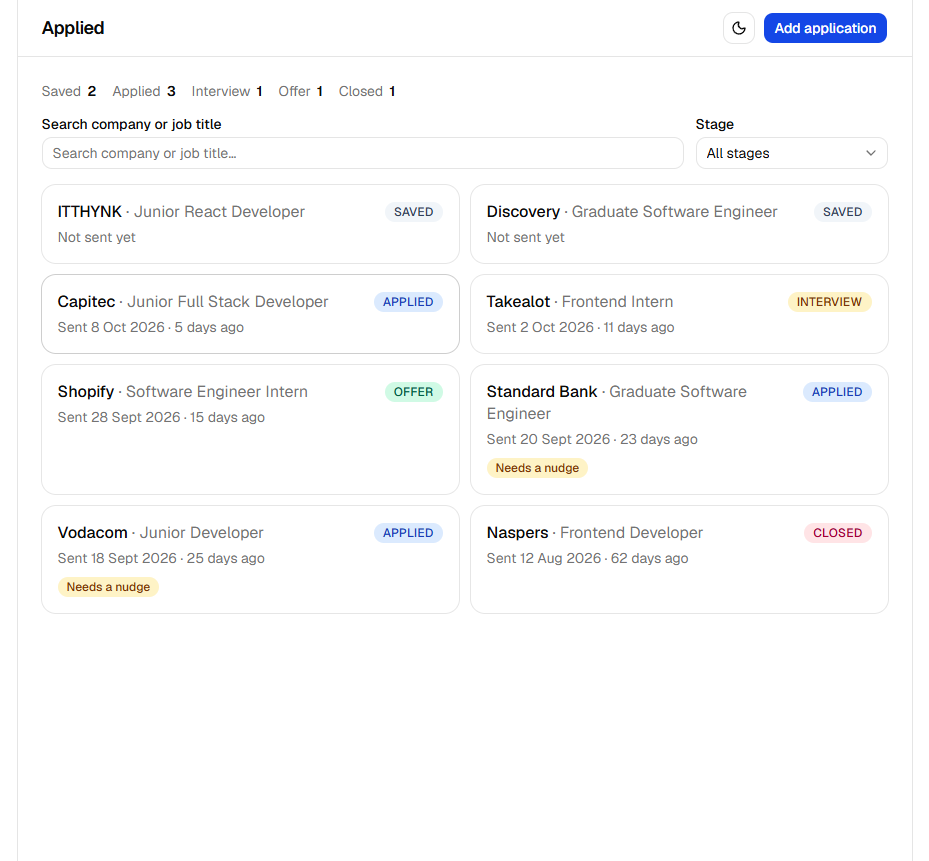

# Applied

A job-application tracker for the ITTHYNK Cohort 2026 React project. It keeps company, role, advert link, date sent, stage, and notes in one list, and flags anything still at **applied** more than fourteen days after you sent it.

The list lives in `localStorage` on this machine. There are no accounts and no server.



## Tools

- React 19 and TypeScript on Vite
- React Router for the four screens
- React Hook Form for the add form
- Tailwind CSS v4 and shadcn/ui (Radix) for layout, theme, and controls
- Vitest, jsdom, and React Testing Library for tests

## Run it locally

```bash
npm install
npm run dev
```

Then open the URL Vite prints (usually `http://localhost:5173/`).

```bash
npm test -- --run
npm run build
```

## Profiler

Typing in the search box re-renders `ApplicationsPage`, `FilterBar`, `StageSummary`, and the cards still on screen, because search state lives on the page. Nothing was memoised after looking.

## What I would do next

Swap `src/api/applications.ts` for a real backend (stretch goal 1), then let TanStack Query own the loading and refresh work that `useApplications` does by hand.
